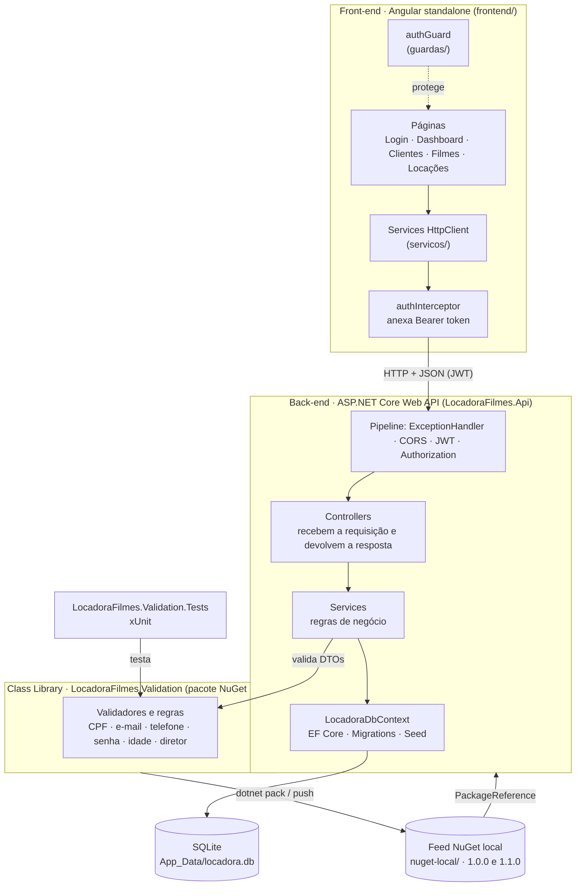
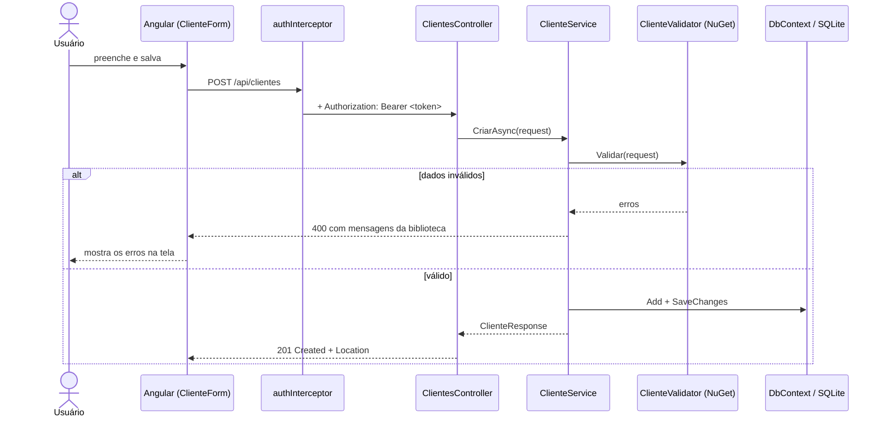
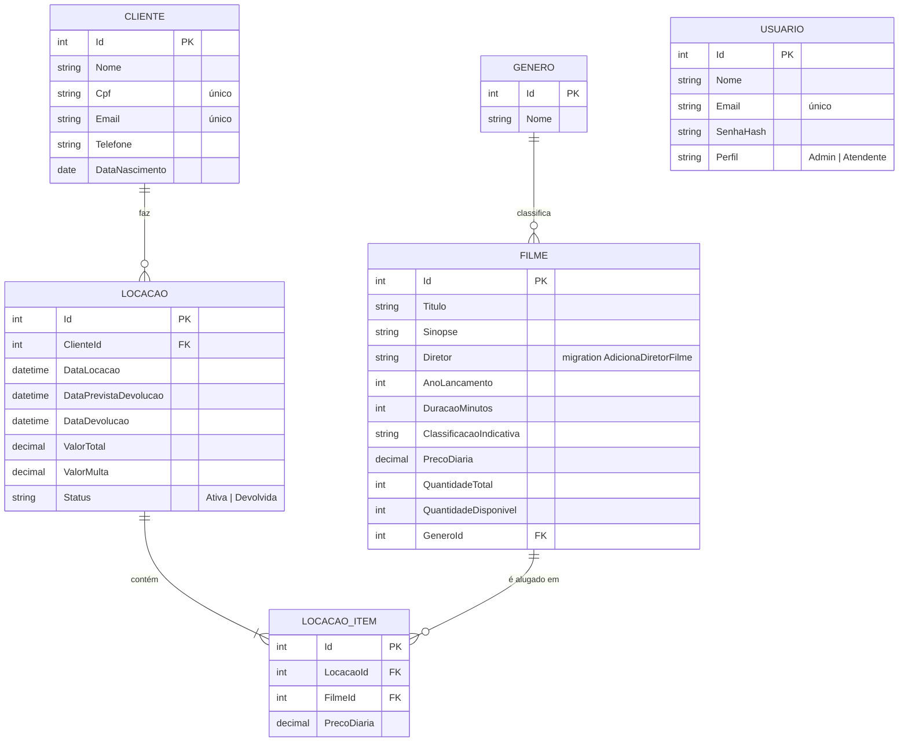

# Arquitetura — Locadora de Filmes

## Camadas

### Responsabilidades

| Camada | Responsabilidade | Não faz |
|--------|------------------|---------|
| **Controllers** | Recebem a requisição, chamam o Service e devolvem o status HTTP (200/201/204) | Regras de negócio ou acesso ao banco |
| **Services** | Regras de negócio (estoque, multa, limite de locações, relatório) e validação via biblioteca | Conhecer detalhes de HTTP |
| **Biblioteca de validação** | Regras de validação de cada entidade, reutilizáveis e testadas | Depender de ASP.NET Core ou EF Core |
| **DbContext / Migrations** | Mapeamento das entidades e evolução do esquema do banco | — |
| **ApiExceptionHandler** | Converte exceções em `ProblemDetails`: validação → 400, não encontrado → 404, conflito → 409, regra de negócio → 422 | — |

### Fluxo de uma requisição (ex.: cadastrar cliente)

## Entidades

## Histórico de migrations

| Migration | Mudança |
|-----------|---------|
| `Inicial` | Criação das tabelas Usuarios, Generos, Filmes, Clientes, Locacoes e LocacaoItens |
| `AdicionaDiretorFilme` | Evolução do modelo: coluna `Diretor` na tabela Filmes |
